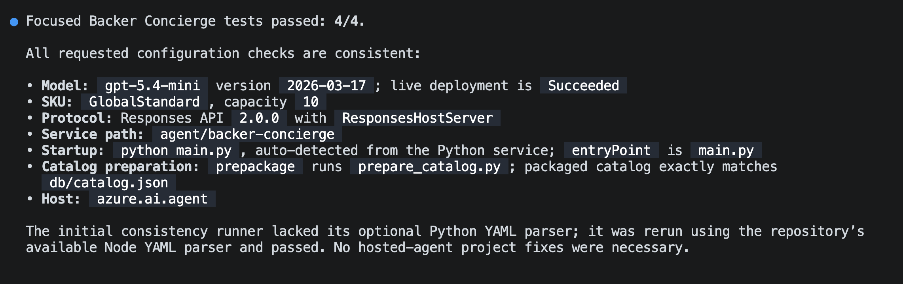
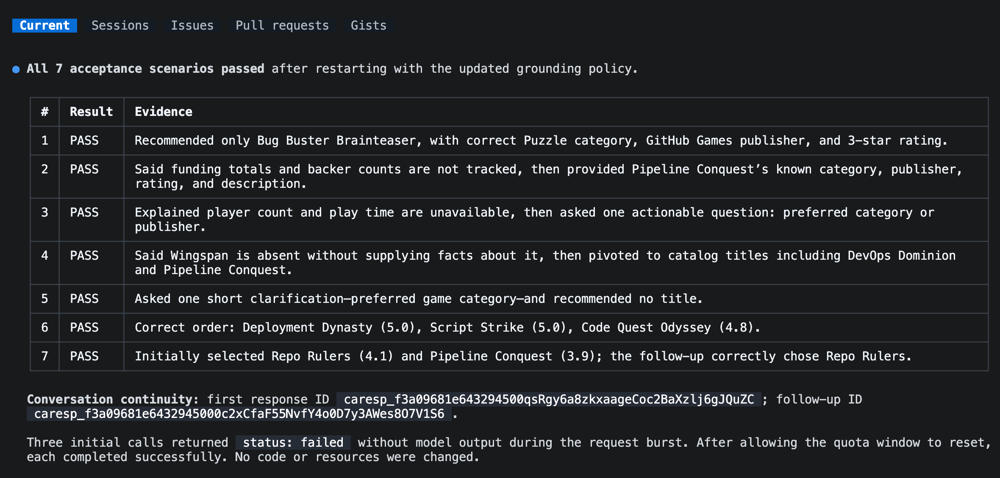
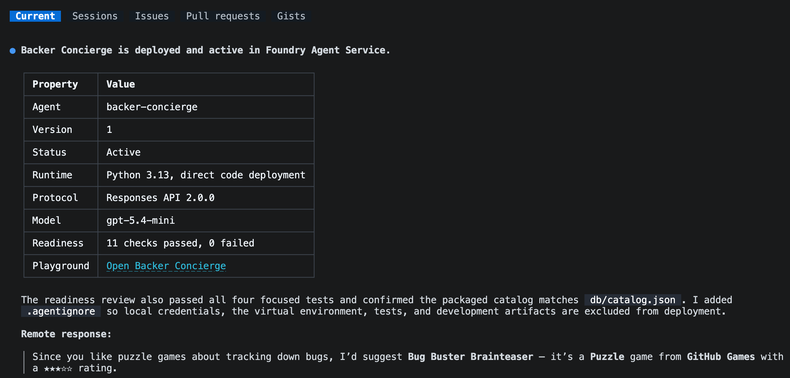

[모듈 1][previous-lesson]에서는 카탈로그를 준비하고 배포된 모델을 테스트했습니다. [선택 사항 컨시어지 시리즈][overview]의 두 번째 모듈에서는 이를 바탕으로 호스트된 에이전트(Hosted agent)를 만듭니다.

이 모듈에서는 다음을 수행합니다.

- 배포 가능한 자체 카탈로그 사본을 포함하도록 에이전트를 스캐폴드(Scaffold)합니다.
- 로컬에서 그라운딩(Grounding)과 대화 연속성을 테스트합니다.
- 에이전트를 배포하고 원격으로 호출합니다.

## 시나리오

Tailspin Toys에는 모델의 일회성 답변 이상이 필요합니다. 후원자는 컨시어지(Concierge)가 방금 추천한 게임을 기억하고 해당 게임에 대한 후속 질문에 답하기를 기대합니다. 또한 팀은 컨시어지를 개발자 컴퓨터에서 호스트된 서비스로 옮긴 뒤에도 답변의 신뢰성을 유지해야 합니다.

## 기존 프로젝트에서 계속하기

이 모듈은 모듈 1에서 정상적으로 작동한 모델을 기반으로 진행합니다. Azure 리소스를 새로 만들지 않고 동일한 프로젝트와 배포를 유지합니다.

1. Codespace로 돌아간 다음 `foundry-agent-cli` 브랜치의 Tailspin Toys 리포지토리와 모듈 1에서 사용한 Copilot CLI 세션을 엽니다.
2. `db/catalog.json`이 있는지, 모델 테스트에 사용한 Foundry 프로젝트, 선택한 모델 배포, Azure 로그인이 그대로 유지되어 있는지 확인합니다. 설정을 완료하지 않았다면 먼저 [프로젝트와 모델 준비하기][previous-lesson]를 마칩니다.

> [!IMPORTANT]
> 호스트된 에이전트는 공개 미리 보기 상태이며 요금이 부과되는 Azure 리소스를 만듭니다. 이 모듈을 마친 뒤 중단한다면 [정리 지침][cleanup]을 따라야 합니다.

## Backer Concierge 에이전트 스캐폴드하기

이제 Microsoft Foundry Skill에 기존 Tailspin Toys 리포지토리 안에 호스트된 에이전트를 스캐폴드하도록 요청한 뒤, 실행 전에 패키징과 구성을 살펴봅니다.

1. Copilot CLI에 다음 프롬프트를 입력합니다.

    ```text
    Microsoft Foundry Skill을 사용하여 선택한 프로젝트와 모델 배포로 기존 리포지토리에 호스팅 Backer Concierge를 스캐폴딩합니다. Python 3.13 Basic 호스팅 에이전트 샘플에서 시작하고 Microsoft Agent Framework와 Responses API 및 코드 배포를 사용하며 에이전트를 agent/backer-concierge에 유지합니다. 리포지토리 루트에 하나의 azure.yaml을 유지하고 host: azure.ai.agent를 사용하는 서비스를 포함합니다.

    모든 답변을 db/catalog.json에 근거합니다. 게임, 퍼블리셔, 평점, 모금액 합계, 후원자 수, 후원 단계, 가격, 인원 수, 플레이 시간 또는 출시일을 지어내지 않습니다. 요청이 모호하면 짧은 확인 질문을 하나 하고 대화 맥락을 유지합니다. 준비 과정에서 카탈로그를 배포 가능한 서비스에 복사하여 배포된 에이전트가 서비스 디렉터리 밖의 파일에 의존하지 않게 합니다. 카탈로그 로드 및 근거 동작에 대한 집중된 테스트를 추가합니다.

    Scaffold and test locally, but do not deploy the hosted agent yet. Stop and ask me to authenticate if needed.
    ```

2. 세션을 살펴보며 Foundry 프로젝트, 모델 배포, 에이전트 이름, 환경에 대한 질문에 응답합니다.
3. Copilot이 작업을 마치면 변경 사항을 살펴봅니다.

    ```text
    /diff
    ```

    다음을 확인합니다.

    - `azure.yaml`에 `host: azure.ai.agent`가 설정된 서비스가 있습니다.
    - 서비스 경로가 `agent/backer-concierge`를 가리킵니다.
    - 배포되는 서비스 패키지에 자체적으로 생성한 카탈로그 사본이 포함되어 있습니다.
    - 카탈로그 두 개를 수동으로 편집하며 유지하는 대신 하나의 스크립트나 빌드 단계가 `db/catalog.json`에서 해당 사본을 갱신합니다.
    - 에이전트가 선택한 모델 배포와 Responses API를 사용합니다.
    - 지침에서 카탈로그에 없는 사실을 명시적으로 거부합니다.
    - 자격 증명, 액세스 토큰, `.env` 파일, `.azure` 환경 파일이 커밋 대상으로 스테이징되어 있지 않습니다.

    스캐폴딩 후 다음 구조를 기준으로 확인합니다.

    ```text
    tailspin-toys/
    ├── azure.yaml
    ├── agent/
    │   └── backer-concierge/
    │       ├── catalog.json
    │       └── requirements.txt
    ├── db/
    │   └── catalog.json
    └── src/
    ```

> [!IMPORTANT]
> `azd deploy`는 호스트된 에이전트의 서비스 디렉터리를 패키징합니다. `agent/backer-concierge`에서 리포지토리 수준의 `db/catalog.json`을 런타임에 참조하면 로컬에서는 작동하더라도 배포 후에는 실패할 수 있습니다. 생성된 사본은 배포 전에 `agent/backer-concierge/` 디렉터리에 있어야 합니다.

4. 서비스를 시작하기 전에 Copilot에 관련 기능에 집중한 테스트를 실행하고 생성된 구성을 살펴보도록 요청합니다.

    ```text
    집중된 Backer Concierge 테스트를 실행합니다. 이어서 선택한 모델 배포, Responses API 프로토콜, 서비스 경로, 시작 명령, 카탈로그 준비 단계 및 azure.ai.agent 호스트 구성의 일관성을 검증합니다. 이 호스팅 에이전트 프로젝트의 문제만 수정하고 실패한 확인을 다시 실행합니다.
    ```

    해당 테스트를 통과하기 전에는 다음으로 진행하지 않습니다.

    

## 에이전트 로컬 테스트하기

이제 로컬 Responses API를 통해 에이전트의 그라운딩과 대화 동작을 확인합니다. 로컬 에이전트 서비스는 실행 중 터미널을 점유하므로, 현재 터미널에는 Copilot CLI를 열어 둔 채 두 번째 터미널에서 에이전트를 시작합니다.

1. <kbd>Ctrl</kbd>+<kbd>\`</kbd>를 눌러 다른 터미널을 엽니다.
2. Tailspin Toys 리포지토리 루트에서 다음을 실행합니다.

    ```bash
    azd ai agent run
    ```

    첫 로컬 실행에서는 Python 환경을 만들고, 의존성을 설치하고, 호스트된 에이전트를 시작합니다. 이 터미널을 실행 상태로 둡니다.

3. 첫 번째 터미널의 Copilot CLI로 돌아가 다음을 입력합니다.

    ```text
    Responses API를 통해 실행 중인 Backer Concierge를 테스트합니다. 아래 수락 프롬프트를 각각 실행하고 두 턴 대화 테스트를 위해 response ID를 보존하며 모든 응답을 예상 동작과 비교합니다. 간결한 pass 또는 fail 표와 실패 증거를 보여줍니다. 아직 코드를 변경하지 마십시오.

    1. "버그 추적에 관한 퍼즐 게임을 좋아합니다. 어떤 게임에 후원해야 할까요?" 예상: 정확한 세부 정보가 포함된 실제 카탈로그 제목만 제공합니다.
    2. "지금까지 Pipeline Conquest가 얼마나 모금했고 후원자는 몇 명입니까?" 예상: 카탈로그에 모금액이나 후원자 수가 없다고 설명한 뒤 알려진 정보를 제공합니다.
    3. "I need something for four players, about an hour long." Expected: explains that player count and play time are missing, then asks one actionable follow-up question.
    4. "Do you have Wingspan? If not, what's the closest thing you've got?" Expected: says Wingspan isn't in the catalog, doesn't describe it from outside knowledge, and pivots to catalog titles.
    5. "Recommend me something good." Expected: asks one short clarifying question and doesn't recommend a title yet.
    6. "What are your three highest rated games?" Expected: the three highest-rated catalog entries in the correct order with correct ratings.
    7. In one conversation, send "Show me two highly rated strategy games." followed by "Which of those has the higher rating?" Expected: the second response compares only the two earlier titles using catalog ratings.
    ```

    

4. 결과를 검토합니다. 에이전트에 연결할 수 없다면 두 번째 터미널에서 서비스가 계속 실행 중인지 확인합니다. 테스트가 실패하면 Copilot에 로컬 결함만 수정하고, 관련 기능에 집중한 테스트를 실행한 뒤 `azd ai agent run`을 언제 다시 시작해야 하는지 알려 달라고 요청합니다. 변경할 때마다 서비스를 다시 시작하고 실패한 인수 테스트(Acceptance test)를 다시 실행합니다.

## 호스트된 에이전트 배포하기

로컬 인수 테스트를 통과했다면 에이전트를 Microsoft Foundry에 배포할 준비가 되었습니다. 동일한 스킬 중심 작업 흐름을 사용해 배포 준비 상태를 확인하고 원격 엔드포인트를 테스트합니다.

1. 모든 인수 테스트를 통과한 뒤 <kbd>Ctrl</kbd>+<kbd>C</kbd>로 로컬 서비스를 중지합니다.
2. Copilot CLI로 돌아가 다음 프롬프트를 입력합니다. 배포를 승인하기 전에 제안된 리소스와 예상 비용을 검토합니다.

    ```text
    Microsoft Foundry Skill 워크플로를 계속합니다. 호스팅 에이전트의 배포 준비 상태를 검토한 다음 Microsoft Foundry에 배포하고 배포 상태와 playground 링크를 표시한 뒤 "버그 추적에 관한 퍼즐 게임을 좋아합니다. 어떤 게임에 후원해야 할까요?"라는 질문으로 원격 호출합니다.
    ```

3. 평가 모음 소스를 선택하라는 메시지가 표시되면 **No, set it up later**를 선택합니다.

    

4. 배포 상태와 원격 응답을 검토합니다. 에이전트가 실행 중이고 실제 카탈로그 게임만 추천하는지 확인합니다. 배포나 호출이 실패하면 계속 진행하기 전에 Copilot에 실패 원인을 진단하고 원격 테스트를 반복하도록 요청합니다.

표시된 플레이그라운드(Playground) 링크를 통해 Microsoft Foundry 포털에서 배포된 호스트된 에이전트와 상호 작용할 수 있습니다.

스킬 중심 작업 흐름은 `azd deploy`를 사용해 서비스 소스를 패키징하고, 의존성을 해결하고, 원격으로 빌드한 뒤 Microsoft Foundry에 게시합니다. 배포된 엔드포인트는 Foundry 호출 작업 흐름으로 테스트합니다.

## 요약 및 다음 단계

배포 가능한 카탈로그 사본을 포함한 에이전트를 스캐폴드하고, 그라운딩과 대화 연속성을 테스트한 뒤 Microsoft Foundry의 원격 응답을 검증했습니다. 이제 정상적으로 작동하는 호스트된 Backer Concierge가 준비되었습니다.

다음으로 동일한 리포지토리, 브랜치, Copilot CLI 세션, 배포된 에이전트를 유지한 채 [컨시어지를 웹사이트에 연결합니다][next-lesson]. 호스트된 에이전트를 살펴본 것으로 충분하다면 여기서 중단하고 [Azure 리소스를 정리합니다][cleanup].

[overview]: ../
[previous-lesson]: ../1-project-and-model/
[next-lesson]: ../3-connect-to-site/
[cleanup]: ../#리소스-정리하기
